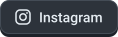

  
<blockquote>
<i>“Naturally curious, always eager to see how the world works. Still searching for what I'm most passionate about, and learning along the way.”</i>
</blockquote>
 

 

## `> about`

- 🎓 **Computer Engineering** at the University of La Laguna (ULL), after a higher vocational degree in **Multiplatform App Development (DAM)** at IES Canarias
- 🏆 **Ocean Hackathon® 2026 winner** in Santa Cruz de Tenerife, qualified for the international final in Brest 🇫🇷
- 🌍 **Erasmus+** internship in Kraków 🇵🇱 building an IAM system
- 🧩 Frontend and backend, databases, integrations and handover documentation
- 🛠️ Personal projects to automate things, from scripts to an ATC app for flight simulation
- 📍 Santa Cruz de Tenerife, Canary Islands

 

## `> stack`

  
<b>Other:</b>
 

 

Made with ❤️ in Tenerife

