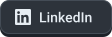

  
<blockquote>
<i>“Curioso de naturaleza, siempre con ganas de ver cómo funciona el mundo. Todavía no sé qué parte de la informática me apasiona más, así que sigo aprendiendo para encontrarla.”</i>
</blockquote>
 

 

## `> about`

- 🎓 **Ingeniería Informática** en la Universidad de La Laguna (ULL), tras terminar el CFGS en **DAM** en IES Canarias
- 🏆 **Ganador del Ocean Hackathon® 2026** en Santa Cruz de Tenerife, clasificado para la final internacional en Brest 🇫🇷
- 🌍 Prácticas **Erasmus+** en Cracovia 🇵🇱 desarrollando un sistema IAM
- 🧩 Frontend y backend, bases de datos, integraciones y documentación de traspaso
- 🛠️ Proyectos propios para automatizar cosas, desde scripts hasta una app de ATC para simulación de vuelo
- 📍 Santa Cruz de Tenerife, Islas Canarias

 

## `> stack`

  
<b>Otros:</b>
 

 

Hecho con ☕ desde Tenerife

